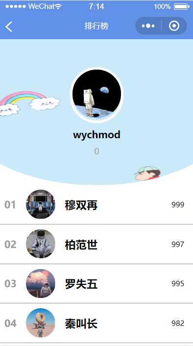
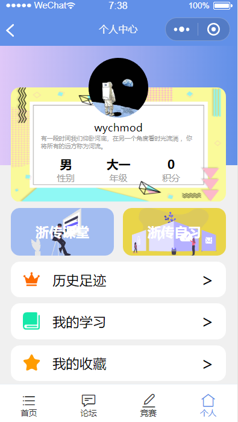
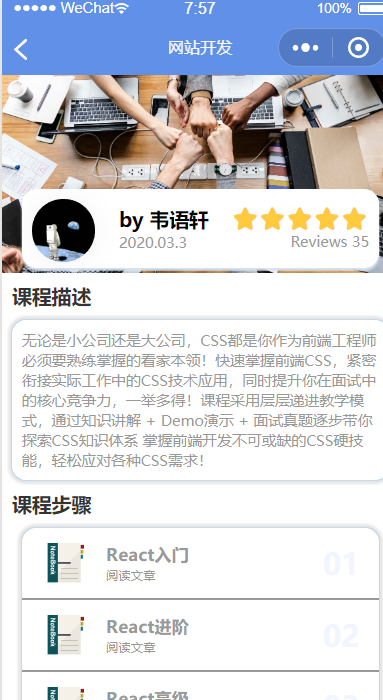
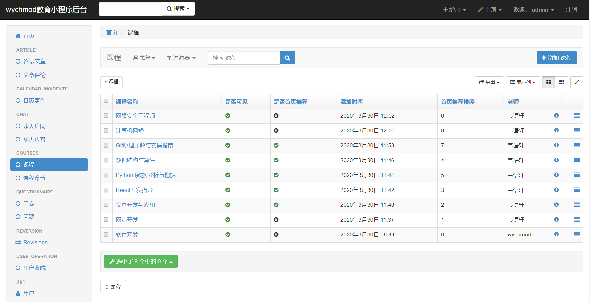

<div align="center">


# 🎓 Taro Education

### 基于 Taro + Django 的多端适配在线教育平台

> 一套代码,八端运行。前后端分离,模块化设计,生产可落地。

[](https://choosealicense.com/licenses/mit/)
[](https://www.python.org/)
[](https://www.djangoproject.com/)
[](https://taro-docs.jd.com/)
[](https://reactjs.org/)
[](http://makeapullrequest.com)
[](https://github.com/wychmod/Taro-Education/stargazers)
[](https://github.com/wychmod/Taro-Education/network/members)

[🌐 效果预览](#-效果预览) · [✨ 核心特性](#-核心特性) · [🏗️ 系统架构](#-系统架构) · [🚀 快速开始](#-快速开始) · [📖 API 文档](#-api-文档) · [🗺️ 路线图](#-路线图)

</div>

---

## 📖 项目简介

**Taro Education** 是一套面向 C 端用户的在线教育类应用,基于 **京东 Taro 多端统一开发框架** 与 **Django REST Framework** 构建,实现了真正的"**一次编写,多端运行**"——同一份 React 源代码可同时编译为**微信小程序、H5、React Native、QQ、百度智能小程序、支付宝小程序、字节跳动小程序、快应用**八端产物。

后端采用 Django 经典的 **App 化拆分** 设计,涵盖课程、章节、文章、问答、问卷、聊天、日历、用户中心、排行榜等完整业务模块,既适合作为**毕业设计 / 课程设计**参考,也具备二次开发为生产项目的骨架基础。

> 🎯 **设计目标**:让前端开发只需关心业务,无需为每个平台写一份重复代码;让后端结构清晰、模块解耦,便于团队协作与持续迭代。

---

## ✨ 核心特性

| 维度 | 特性 |
| --- | --- |
| 📱 **多端覆盖** | 一套 React 源码同时输出微信小程序 / H5 / RN / QQ / 百度 / 支付宝 / 字节 / 快应用 |
| 🎨 **UI 体系** | 基于 `taro-ui` 组件库 + 自研共享组件,统一视觉与交互规范 |
| 🏪 **状态管理** | Mobx + `@tarojs/mobx` 集中管理,清晰可维护 |
| 🔐 **鉴权安全** | JWT Token 鉴权 + 自定义 `CustomBackend` 多方式登录 + 短信验证码 |
| 🛡️ **后台管理** | xadmin + DjangoUeditor 富文本 + reversion 版本控制 + 自动注册模型 |
| 🗄️ **数据建模** | 8 大业务 App 完全解耦,模型独立,迁移文件齐全 |
| 🌐 **跨域支持** | `django-cors-headers` 全局开启 CORS,前后端分离无忧 |
| 🚦 **接口限流** | DRF 内置 Throttle,匿名 5/min、用户 10/min 防刷 |
| 📡 **实时通信** | WebSocket 聊天模块,支持即时消息 |
| 📝 **内容运营** | 集成 UEditor 富文本编辑器,支持图文课程章节 |
| 📚 **自动文档** | DRF `include_docs_urls` 自动生成 API 文档 |

---

## 🏗️ 系统架构

```
                       ┌──────────────────────────────────────┐
                       │           用户终端 (8 端)              │
                       ├──────────────────────────────────────┤
                       │ 微信小程序  H5  RN   QQ   百度        │
                       │ 支付宝小程序 字节跳动  快应用          │
                       └──────────────────┬───────────────────┘
                                          │  HTTP / WebSocket
                                          ▼
        ┌─────────────────────────────────────────────────────────────┐
        │                    TaroEducation (前端)                      │
        │  ┌──────────┐  ┌──────────┐  ┌──────────┐  ┌──────────┐    │
        │  │  Pages   │  │Components│  │  Store   │  │  Utils   │    │
        │  │ (13页面) │  │ (共享组件)│  │ (Mobx×6) │  │ (工具函数)│    │
        │  └──────────┘  └──────────┘  └──────────┘  └──────────┘    │
        │                          taro-ui / axios                    │
        └──────────────────────────────┬──────────────────────────────┘
                                       │  REST API  +  JWT
                                       ▼
        ┌─────────────────────────────────────────────────────────────┐
        │                  EducationBackend (后端)                     │
        │  ┌──────────────────────────────────────────────────────┐  │
        │  │              DRF + JWT + Throttle + CORS             │  │
        │  └──────────────────────────────────────────────────────┘  │
        │  ┌─────┐ ┌────────┐ ┌──────┐ ┌──────────┐ ┌────────────┐  │
        │  │user │ │courses │ │article│ │question- │ │calendar_   │  │
        │  │     │ │        │ │       │ │naire     │ │incidents   │  │
        │  └─────┘ └────────┘ └──────┘ └──────────┘ └────────────┘  │
        │  ┌─────────┐ ┌──────┐ ┌───────────────┐                    │
        │  │chat (WS)│ │rank  │ │user_operation │  + xadmin 后台    │
        │  └─────────┘ └──────┘ └───────────────┘                    │
        └──────────────────────────────┬──────────────────────────────┘
                                       │
                                       ▼
                          ┌────────────────────────┐
                          │       MySQL 5.7+       │
                          └────────────────────────┘
```

---

## 📂 项目目录结构

```text
Taro-Education/
├── 📁 TaroEducation/                  # 前端工程 (Taro 2.1 + React)
│   ├── 📁 src/
│   │   ├── 📁 pages/                  # 13 个页面
│   │   │   ├── index/                 #   首页
│   │   │   ├── course/                #   课程详情
│   │   │   ├── chapter/               #   章节学习
│   │   │   ├── list/                  #   列表
│   │   │   ├── forum/                 #   论坛
│   │   │   ├── question/              #   问答
│   │   │   ├── questionnaire/         #   问卷
│   │   │   ├── rank/                  #   排行榜
│   │   │   ├── calendar/              #   日历事件
│   │   │   ├── chat/                  #   聊天
│   │   │   ├── person/                #   个人中心
│   │   │   ├── login/                 #   登录
│   │   │   └── register/              #   注册
│   │   ├── 📁 components/             # 共享业务组件
│   │   ├── 📁 store/                  # Mobx 状态层 (6 个)
│   │   ├── 📁 constants/              # 全局常量
│   │   ├── 📁 utils/                  # 工具方法
│   │   ├── 📁 assets/                 # 静态资源 / 字体
│   │   ├── app.jsx                    # 应用入口
│   │   └── app.scss                   # 全局样式
│   ├── 📁 config/                     # Taro 构建配置 (dev / prod / index)
│   ├── package.json                   # 依赖声明 (含 weapp/h5/rn/... 全端)
│   └── project.config.json            # 小程序工程配置
│
├── 📁 EducationBackend/               # 后端 Django 工程
│   ├── settings.py                    # 配置:DB / JWT / CORS / Throttle
│   ├── urls.py                        # 路由:API + xadmin + 文档 + 媒体
│   ├── wsgi.py / asgi.py              # WSGI / ASGI 入口
│
├── 📁 apps/                           # 业务 App 集合
│   ├── user/                          # 用户体系 (JWT + 短信)
│   ├── courses/                       # 课程 & 章节
│   ├── article/                       # 文章
│   ├── questionnaire/                 # 问卷
│   ├── calendar_incidents/            # 日历事件
│   ├── chat/                          # WebSocket 聊天
│   ├── user_operation/                # 用户操作 (收藏 / 评论)
│   └── utils/                         # 通用工具
│
├── 📁 extra_apps/                     # 第三方扩展 App
│   └── DjangoUeditor/                 # 百度 UEditor 后端
│
├── 📁 db_tools/                       # 数据导入脚本
│   ├── import_calendar_data.py
│   └── import_user_data.py
│
├── 📁 media/                          # 用户上传文件
│   ├── chapters/                      # 章节图文
│   ├── course/                        # 课程封面
│   └── head_portrait/                 # 头像
│
├── manage.py                          # Django 启动入口
├── LICENSE                            # MIT 协议
└── README.md                          # 你正在读的这份文档
```

---

## 🛠️ 技术栈

### 前端

| 技术 | 版本 | 用途 |
| --- | --- | --- |
| **Taro** | 2.1.0 | 京东开源多端统一框架 |
| **React** | 16.x | UI 视图层 |
| **Mobx** | 4.8.0 | 状态管理 |
| **taro-ui** | ^2.3.2 | UI 组件库 |
| **taro-axios** | ^1.1.0 | HTTP 请求封装 |
| **taro-parse** | ^1.1.4 | 富文本渲染 |
| **taro-canvas-code** | ^1.0.2 | 二维码 / 海报生成 |
| **Sass** | - | CSS 预编译 |

### 后端

| 技术 | 版本 | 用途 |
| --- | --- | --- |
| **Python** | 3.7+ | 开发语言 |
| **Django** | 3.0.4 | Web 框架 |
| **Django REST Framework** | - | RESTful API |
| **djangorestframework-jwt** | - | JWT 鉴权 |
| **xadmin** | - | 后台管理(替代 admin) |
| **DjangoUeditor** | - | 百度 UEditor 富文本 |
| **django-cors-headers** | - | 跨域支持 |
| **django-crispy-forms** | - | 表单渲染 |
| **django-reversion** | - | 模型版本控制 |
| **MySQL** | 5.7+ | 数据存储 |

---

## 🚀 快速开始

### 0. 环境要求

| 依赖 | 版本 | 说明 |
| --- | --- | --- |
| Python | 3.7+ | 后端运行环境 |
| Node.js | 12+ | 前端构建工具链 |
| MySQL | 5.7+ | 数据库 |
| 小程序 IDE | 最新版 | 微信开发者工具 / HBuilder 等 |

### 1. 克隆仓库

```bash
git clone git@github.com:wychmod/Taro-Education.git
cd Taro-Education
```

### 2. 启动后端

```bash
# ① 创建并激活虚拟环境
python -m venv venv
source venv/bin/activate        # Windows: venv\Scripts\activate

# ② 安装依赖
pip install django==3.0.4 \
            djangorestframework \
            djangorestframework-jwt \
            django-cors-headers \
            django-crispy-forms \
            django-reversion \
            xadmin \
            PyMySQL \
            Pillow

# ③ 创建数据库
mysql -uroot -p -e "CREATE DATABASE educationbackend DEFAULT CHARSET utf8mb4;"

# ④ 修改 EducationBackend/settings.py 中的数据库账号密码

# ⑤ 执行迁移
python manage.py makemigrations
python manage.py migrate

# ⑥ 创建后台账号
python manage.py createsuperuser

# ⑦ (可选) 导入演示数据
python db_tools/import_user_data.py
python db_tools/import_calendar_data.py

# ⑧ 启动服务
python manage.py runserver 0.0.0.0:8000
```

启动后可访问:

| 地址 | 用途 |
| --- | --- |
| <http://localhost:8000/admin/> | xadmin 后台 |
| <http://localhost:8000/doc/> | DRF 自动 API 文档 |
| <http://localhost:8000/api/> | RESTful 接口前缀 |

### 3. 启动前端

```bash
# 微信小程序(主推)
cd TaroEducation
npm install
npm run dev:weapp        # 产物输出至 dist/

# 其它端按需取用
npm run dev:h5           # H5
npm run dev:rn            # React Native
npm run dev:swan          # 百度智能小程序
npm run dev:alipay        # 支付宝小程序
npm run dev:tt            # 字节跳动小程序
npm run dev:qq            # QQ 小程序
npm run dev:quickapp      # 快应用
```

> 💡 用对应端 IDE 打开 `dist/` 目录即可预览。微信小程序请使用**微信开发者工具**导入项目。

---

## 📦 业务模块

| 模块 | 后端 App | 前端页面 | 说明 |
| --- | --- | --- | --- |
| 👤 用户体系 | `apps/user` | `login` / `register` / `person` | 自定义 `UserProfile`、手机号注册、JWT 登录、短信验证码 |
| 📚 课程中心 | `apps/courses` | `index` / `course` / `chapter` / `list` | 课程列表、详情、富文本章节学习 |
| 📝 论坛/问答 | `apps/article` | `forum` / `question` | 文章发布与问答互动 |
| 📋 问卷调查 | `apps/questionnaire` | `questionnaire` | 自定义问卷,提交即记录 |
| 📅 日历事件 | `apps/calendar_incidents` | `calendar` | 学习计划与日程管理 |
| 🏆 排行榜 | `apps/user_operation` | `rank` | 学习时长/积分多维度排行 |
| 💬 即时聊天 | `apps/chat` | `chat` | WebSocket 实时通信 |
| ⚙️ 用户操作 | `apps/user_operation` | - | 收藏、点赞、评论等行为记录 |

---

## 📖 API 文档

项目启动后访问 `http://localhost:8000/doc/` 可查看由 DRF 自动生成的可交互 API 文档。

主要路由(`EducationBackend/urls.py`):

| Method | Endpoint | 描述 | 鉴权 |
| --- | --- | --- | --- |
| `POST` | `/login/` | JWT 登录换取 Token | ❌ |
| `GET/POST` | `/api/courses/` | 课程列表 / 新建 | ✅ |
| `GET/POST` | `/api/chapter/` | 章节列表 / 新建 | ✅ |
| `GET/POST` | `/api/calendar/` | 日历事件 | ✅ |
| `GET/POST/PUT` | `/api/user/` | 用户信息 | ✅ |
| `GET` | `/api/rank/` | 排行榜 | ✅ |
| `POST` | `/api/codes/` | 发送短信验证码 | ❌ |
| `GET/POST` | `/api/questionnaire/` | 问卷提交与查询 | ✅ |

> 鉴权方式:请求头携带 `Authorization: JWT <your_token>`

---

## 🖼️ 效果预览

### C 端用户界面(微信小程序)

| 页面 | 截图 |
| --- | --- |
| 首页 |  |
| 课程 |  |
| 章节 |  |
| 个人中心 |  |

### 后台管理(xadmin)



---

## 🗺️ 路线图

- [x] **v1.0** — 基础框架与核心模块(课程 / 用户 / 章节)
- [x] **v1.1** — 集成聊天 / 日历 / 问卷 / 排行榜
- [x] **v1.2** — 八端构建脚本打通
- [ ] **v2.0** — 升级 Taro 3 + React 18 + TypeScript
- [ ] **v2.1** — 接入 Vue3 / NutUI 多端支持(可选)
- [ ] **v2.2** — 课程购买 / 支付模块
- [ ] **v2.3** — 视频点播 / 直播课集成
- [ ] **v3.0** — 微服务拆分 + Docker / K8s 部署
- [ ] **v3.1** — 接入 Elasticsearch 全文检索

> 欢迎在 [Issues](https://github.com/wychmod/Taro-Education/issues) 中提出你的想法 🎉

---

## 🤝 贡献指南

我们欢迎任何形式的贡献!

1. **Fork** 本仓库
2. 创建你的特性分支 (`git checkout -b feature/AmazingFeature`)
3. 提交你的修改 (`git commit -m 'Add some AmazingFeature'`)
4. 推送到分支 (`git push origin feature/AmazingFeature`)
5. 发起 **Pull Request**

### 代码规范

- **Python**:遵循 [PEP 8](https://www.python.org/dev/peps/pep-0008/),使用 `flake8` / `black`
- **JavaScript**:遵循 `eslint-config-taro` 规范
- **Commit Message**:推荐 [Conventional Commits](https://www.conventionalcommits.org/)

---

## 🐛 问题反馈

发现 Bug 或有新需求?请通过以下方式:

- 🐞 [提交 Issue](https://github.com/wychmod/Taro-Education/issues/new)
- 💬 评论区留言
- 📧 邮件联系作者(见下方)

---

## 📄 开源协议

本项目基于 [MIT License](https://choosealicense.com/licenses/mit/) 开源 —— 你可以自由使用、修改、分发,只需保留版权声明。

```
MIT License

Copyright (c) 2020 wychmod

Permission is hereby granted, free of charge, to any person obtaining a copy
of this software and associated documentation files (the "Software"), to deal
in the Software without restriction, including without limitation the rights
to use, copy, modify, merge, publish, distribute, sublicense, and/or sell
copies of the Software, and to permit persons to whom the Software is
furnished to do so, subject to the following conditions:

The above copyright notice and this permission notice shall be included in all
copies or substantial portions of the Software.
```

---

## 👨‍💻 关于作者

**wychmod** —— 一名热爱技术与分享的全栈工程师。

如果这个项目对你有帮助:
- ⭐ 给个 **Star** 是对我最大的鼓励
- 🍴 **Fork** 走,在自己手里继续打磨
- 📢 **分享** 给身边正在做毕设 / 学 Taro 的朋友

<div align="center">

**Made with ❤️ by [wychmod](https://github.com/wychmod)**

<sub>🎓 让学习更简单,让开发更有趣。</sub>

</div>